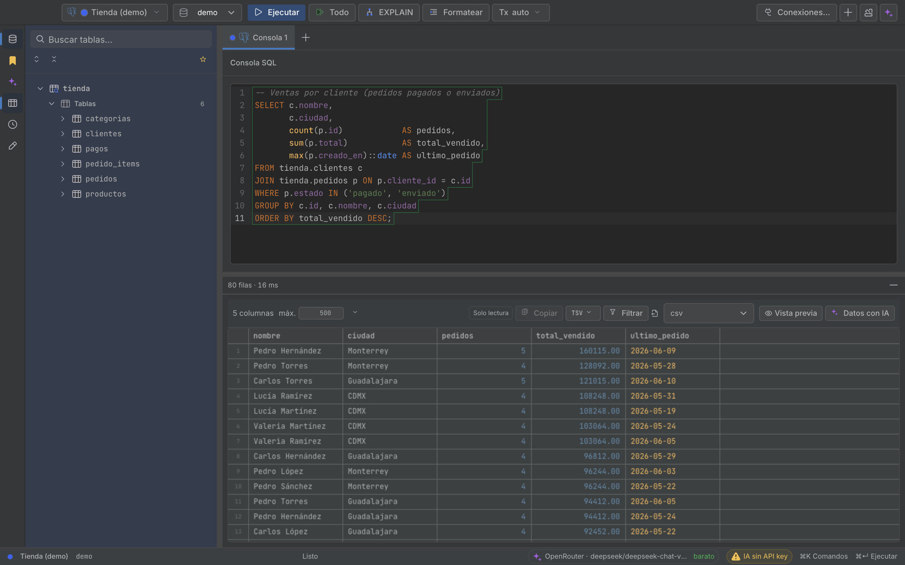
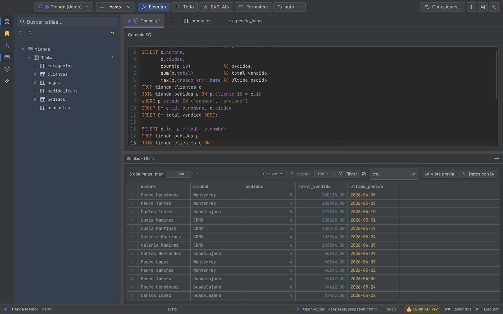
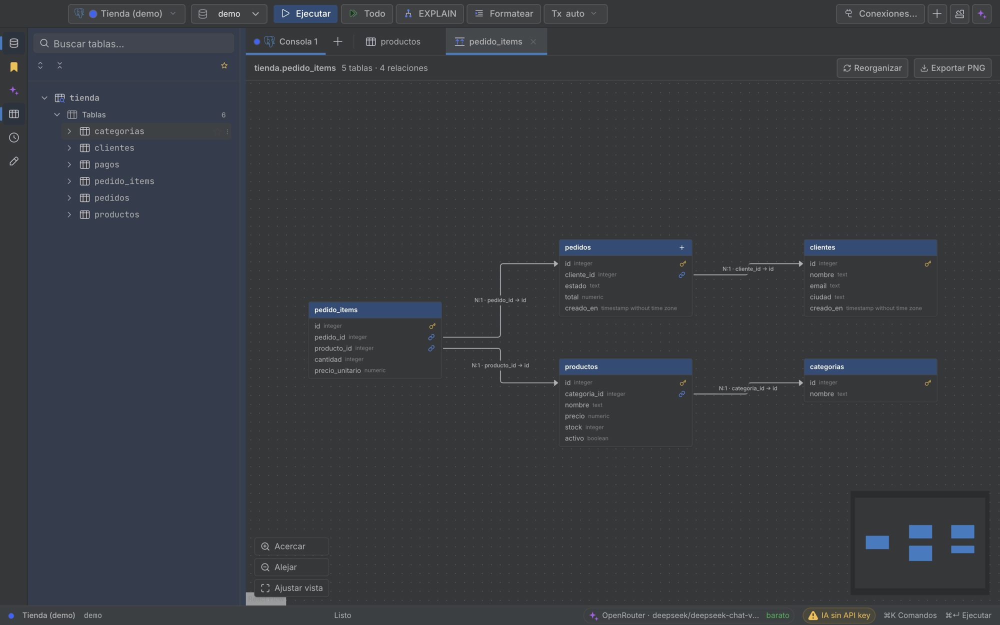
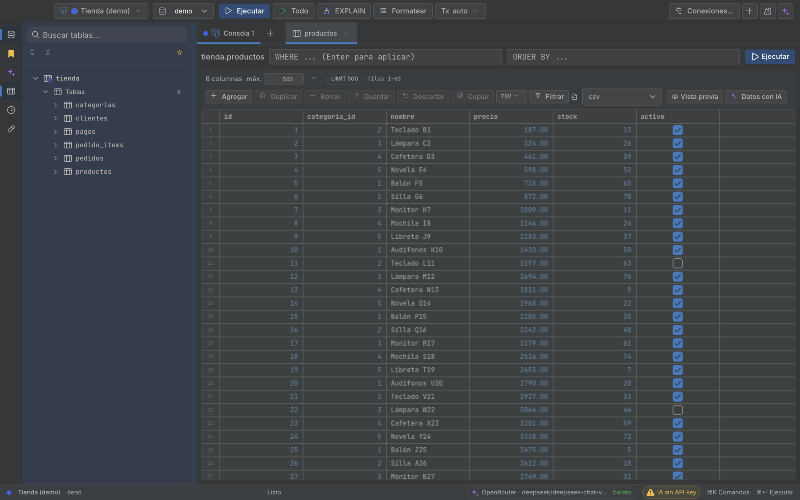
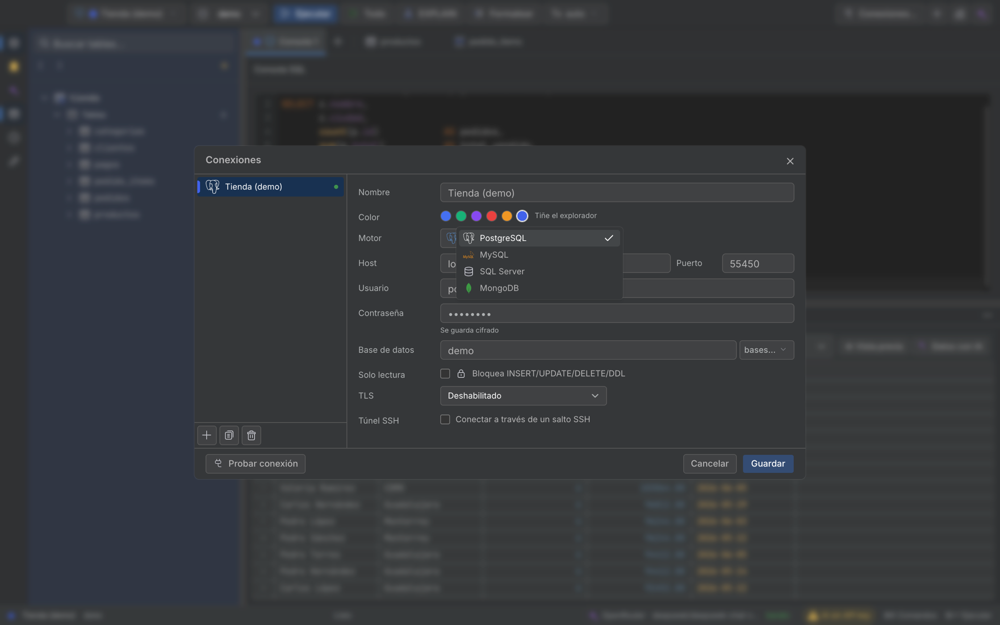
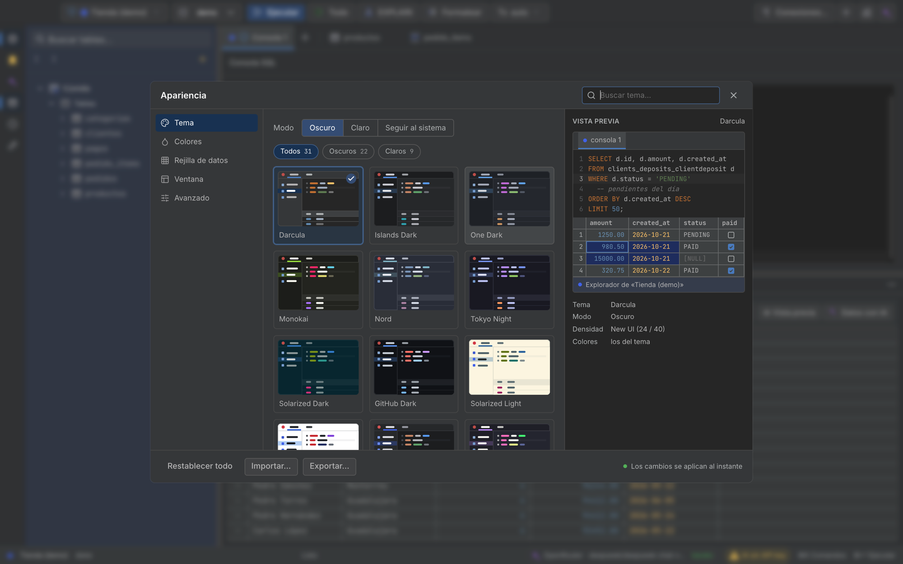
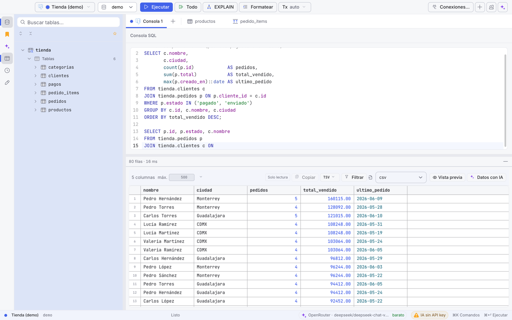

# DataDB

Cliente de bases de datos de escritorio para macOS, inspirado en la experiencia de JetBrains DataGrip:
multi-conexión, explorador de esquema, consola SQL con autocompletado que entiende tus claves foráneas,
rejilla de resultados rápida, diagramas ER y un asistente de IA para tareas SQL.

**Código abierto (MIT).** Úsalo, mejóralo y manda tus features.

[**⬇ Descargar DataDB para macOS (Apple Silicon)**](https://github.com/bit-armando/datadb/releases/latest)



## Características

- **Motores**: PostgreSQL, MySQL / MariaDB, SQL Server y MongoDB.
- **Conexiones seguras**: contraseñas cifradas con el Llavero de macOS, TLS configurable, túnel SSH y
  modo *solo lectura* que bloquea INSERT/UPDATE/DELETE/DDL.
- **Consola SQL**: varias consolas por conexión, ejecutar la sentencia actual o todo el script,
  `EXPLAIN`, formateo, transacciones automáticas o manuales (commit / rollback), historial y log de SQL.
- **Autocompletado por contexto**: después de `FROM` sugiere tablas, y en un `JOIN … ON` propone la
  condición correcta a partir de las claves foráneas.
- **Rejilla de resultados**: miles de filas sin trabarse, filtros por columna, ordenamiento, columnas
  redimensionables que se recuerdan, edición de celdas y exportación a CSV, JSON, Markdown o SQL.
- **Vista de tabla y diagramas ER**: abre cualquier tabla con un clic, explora sus relaciones en un
  diagrama interactivo y expórtalo a PNG.
- **Consultas guardadas y favoritos** por conexión, más paleta de comandos (`⌘K`).
- **MongoDB**: colecciones con filtros, vista de documentos y edición.
- **31 temas** (Darcula, One Dark, Nord, Tokyo Night, GitHub, Catppuccin, Solarized…), con modo claro,
  oscuro o seguir al sistema.
- **Asistente de IA** (OpenRouter, opcional): texto a SQL, corregir errores, explicar, convertir entre
  dialectos y optimizar. El SQL generado **nunca** se ejecuta sin que tú lo confirmes.

| Autocompletado con JOIN por clave foránea | Diagrama ER |
| --- | --- |
|  |  |
| **Vista de tabla** | **Conexiones** |
|  |  |
| **Apariencia y temas** | **Tema claro** |
|  |  |

## Instalación

1. Descarga el `.dmg` más reciente desde
   [Releases](https://github.com/bit-armando/datadb/releases/latest).
2. Ábrelo y arrastra **DataDB** a **Aplicaciones**.
3. La primera vez: **clic derecho sobre DataDB ▸ Abrir ▸ Abrir** (la app no está notarizada por
   Apple, ver abajo). Las siguientes veces abre con doble clic.

Si macOS dice que la app «está dañada» o no deja abrirla:

```bash
xattr -dr com.apple.quarantine /Applications/DataDB.app
```

**Requisitos**: macOS 12 o superior en Apple Silicon (M1 o posterior). No hace falta Node, Homebrew ni
Docker: todo va dentro del `.dmg`. Más detalles en [README-instalacion.md](README-instalacion.md).

> **¿Por qué el aviso de «desarrollador no identificado»?** Firmar y notarizar con Apple requiere una
> cuenta de desarrollador de pago. El `.dmg` se firma *ad-hoc*; el código es el de este repo y puedes
> compilarlo tú mismo (ver abajo).

### Dónde guarda tus datos

`~/Library/Application Support/DataDB/`: conexiones (sin contraseñas), historial, consultas guardadas y
preferencias. Las contraseñas y la clave de IA van cifradas con `safeStorage` de Electron (Llavero de
macOS) y no viajan a otra Mac.

## Desarrollo

Stack: Electron + Vite (electron-vite) + React 19 + TypeScript + Tailwind v4.

Requisitos: macOS y Node.js `^20.19` o `>=22.12` (recomendado: Node 22 o 24 LTS).

```bash
git clone https://github.com/bit-armando/datadb.git
cd datadb
npm install
npm run dev          # abre la app en modo desarrollo
```

| Comando | Qué hace |
| --- | --- |
| `npm run dev` | Arranca la app con recarga en caliente. |
| `npm run lint` | ESLint. |
| `npm run typecheck` | `tsc --noEmit` (electron-vite no comprueba tipos). |
| `npm test` | Tests (`tsx --test` sobre `src/**/*.test.ts` y `electron/**/*.test.ts`). |
| `npm run build` | Compila el bundle de Electron en `out/`. |
| `npm run dist` | Genera `release/DataDB-<versión>-arm64.dmg`. |
| `npm run instalar` | Compila y copia la app a `/Applications` (útil para probar cambios). |

Antes de abrir un PR: `npm run lint && npm run typecheck && npm test && npm run build`.

Para probar contra bases desechables sin tocar tus datos reales, arranca la app con un directorio de
datos aislado (ruta absoluta):

```bash
DATADB_DATA_DIR=/tmp/datadb-pruebas npm run dev
```

### Estructura

```
electron/        Proceso main + preload + utilityProcess de base de datos
  main.ts          ventana, broker renderer↔worker, cifrado de secretos (safeStorage)
  preload.ts       superficie IPC acotada que se expone al renderer
  db-worker.ts     utilityProcess que aloja sesiones, pools y drivers de BD
  broker.ts        correlación de peticiones/respuestas con el worker
src/
  renderer/        entrada del renderer (main.tsx, globals.css, fonts.css)
  components/      componentes React (editor SQL, rejilla, árbol, diálogos…)
  server/          lógica del worker: drivers de BD, handlers IPC, IA, perfiles
  shell/           pestañas, layout y atajos de teclado
  theme/           sistema de temas
  icons/           iconos (set de IntelliJ, Apache 2.0) e iconos propios
index.html       entrada de Vite
```

Flujo: `renderer --invoke--> main (valida) --postMessage--> db-worker --> drivers`. `main` no toca
ninguna base de datos: valida el remitente, aplica la lista blanca de canales y reenvía.

## Asistente de IA (opcional)

La IA usa [OpenRouter](https://openrouter.ai): configura tu clave en **Ajustes de IA** dentro de la app
(se guarda cifrada en el Llavero). Cada quien usa su propia clave. En desarrollo también se acepta la
variable `OPENROUTER_API_KEY` (ver `.env.example`).

- **Texto a SQL** (`⌘⇧Y`), **corregir errores** desde el banner de error, y panel lateral para
  **explicar, convertir y optimizar**.
- **Selector de modelo** con favoritos; los modelos DeepSeek se destacan como opción barata.
- Por defecto solo se envía el **esquema** (tablas, columnas, tipos, FKs), nunca filas. La única
  excepción es «Resumir filas», que pide confirmación indicando cuántas filas se enviarán.
- El SQL generado nunca se ejecuta solo, hay avisos para sentencias destructivas, y en conexiones de
  solo lectura se bloquean las sentencias que no sean `SELECT`.

## Contribuir

¡Bienvenidas las contribuciones! Lee [CONTRIBUTING.md](CONTRIBUTING.md) para el flujo de issues y PRs.

## Licencia

[MIT](LICENSE). Los iconos de `src/icons/intellij/` provienen de
[JetBrains/intellij-community](https://github.com/JetBrains/intellij-community) bajo Apache 2.0 (ver
`src/icons/intellij/NOTICE.txt`). DataDB no está afiliado a JetBrains; DataGrip es marca de
JetBrains s.r.o.
